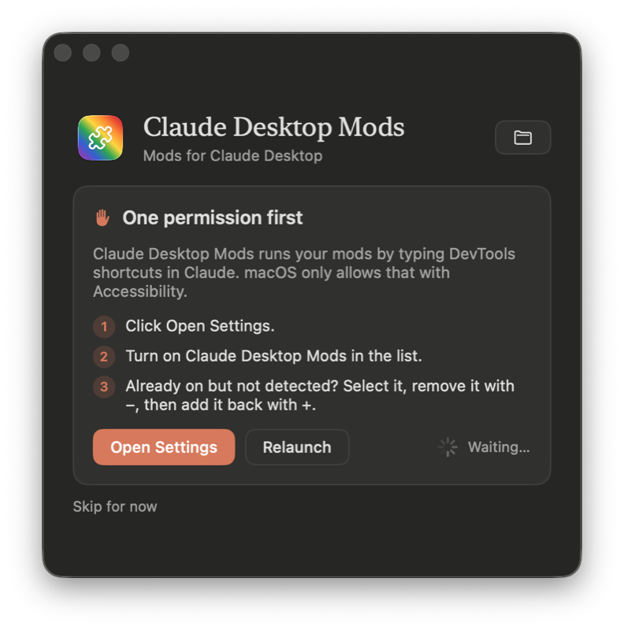

# Claude Desktop Mods

Mods to customize and extend the Claude desktop app. CDM for short.

<p align="center">
  
</p>

> **Unofficial.** Not made, supported, or endorsed by Anthropic. CDM runs through Claude's
> own Developer Mode and DevTools; the Claude app itself is never modified.

## Mods

| Mod | What it does |
|---|---|
| [`color-tabs`](mods/color-tabs) | Turns each project in the sidebar into a colored block with its own icon, like tab groups in Arc. Pick from 2,000+ [Lucide](https://lucide.dev) icons and show the latest sessions with "Show more" for the rest. Settings: how a running session shows (moving light, pulsing border, dot on the icon, or none), routines in their own block, and sessions per block. |

## Requirements

- macOS 14 or later, with the Claude desktop app
- Python 3 and git
- The Xcode command line tools: `xcode-select --install`

## Install

**1. Get the code and build the app.** In Terminal:

```bash
git clone https://github.com/thomasdqr/claude-desktop-mods ~/Documents/GitHub/claude-desktop-mods \
  || git -C ~/Documents/GitHub/claude-desktop-mods pull
python3 ~/Documents/GitHub/claude-desktop-mods/app/build.py
open ~/Applications/"Claude Desktop Mods.app"
```

**2. Allow Accessibility.** The app asks for it first: click **Open Settings** and turn on
Claude Desktop Mods. It needs it to type the DevTools shortcuts in Claude for you.

<p align="center">
  
</p>

**3. Install a mod.** Open **Catalog** and click **Install** next to a mod. Then click
**Restart Claude** at the bottom. The mods run a few seconds after Claude opens, and the app
runs them again at each launch. In **Settings**, turn on **Open at login** so it's always
ready in the menu bar.

## The app

- **Installed**: your mods. Each has a switch, and the sliders button shows its settings
  and **Remove**.
- **Catalog**: every mod in `mods/`, with **Install**.
- **Settings**: run mods when Claude opens, open at login, the status of each piece, and
  **Turn off mods** or **Uninstall…**.

A change applies when Claude restarts. The bar at the bottom offers **Restart Claude**.

Your choices are saved in `settings.json`, which you can also edit by hand:

```json
{
  "mods": {
    "color-tabs": {
      "enabled": true,
      "settings": {
        "runningAnimation": "pulse",
        "routinesBlock": true,
        "visibleRows": 5,
        "projects": { "my-project": { "color": "#3DBE7A", "icon": "sprout" } }
      }
    }
  }
}
```

After editing it by hand, or after a `git pull`, switch the mod off and on in the app, then
click **Restart Claude**.

## Write a mod

A mod is a folder in `mods/` with two files:

```
mods/my-mod/
  manifest.json   id, name, version, description, author, icon, settings, assets
  main.js         defines activate(api)
```

```js
function activate(api) {
  api.css(`[data-group-name] { letter-spacing: 0.02em; }`);
  api.watch(() => {
    for (const section of api.sidebar.sections()) {
      // runs once per frame after Claude's page changes
    }
  });
}
```

The app shows `icon` as an [SF Symbol](https://developer.apple.com/sf-symbols/) on a tint:
`"icon": { "symbol": "swatchpalette.fill", "color": "#F0609E" }`.

Settings go in the manifest as a list, and the app builds their controls in that order:

```json
"settings": [
  { "key": "style", "type": "choice", "label": "Style", "description": "How it looks.",
    "options": [{ "value": "soft", "label": "Soft" }, { "value": "bold", "label": "Bold" }],
    "default": "soft" },
  { "key": "compact", "type": "toggle", "label": "Compact", "description": "Tighter rows.", "default": false },
  { "key": "limit", "type": "number", "label": "Limit", "description": "How many.", "min": 1, "max": 20, "default": 5 },
  { "key": "data", "type": "hidden", "description": "Edited elsewhere, like color-tabs' projects.", "default": {} }
]
```

What `api` gives a mod:

| | |
|---|---|
| `api.settings` | the manifest's defaults, overridden by `settings.json` |
| `api.assets` | the manifest's JSON assets, already parsed |
| `api.storage.get/set` | JSON values kept in Claude, namespaced to the mod |
| `api.css(text)` | a stylesheet, removed when the mod stops |
| `api.watch(callback)` | runs once per frame after the page changes |
| `api.onCleanup(fn)` | runs when the mod stops |
| `api.sidebar` | helpers for Claude's sidebar markup: `sections()`, `routines()`, `title()`, `label()`, `rowList()`, `isRunning()`… |

Claude's markup lives in [`runtime/runtime.js`](runtime/runtime.js), so a Claude update gets
fixed there once for every mod. A mod that throws is logged and stopped; the others keep
running. Run `python3 install.py` to try a mod.

A mod runs inside Claude with your session, so it can read your conversations and act as
you. Mods here must not load or evaluate code from elsewhere (`fetch` of scripts, `eval`,
`import()`), and every change is reviewed in a pull request.

## How it works

1. **Developer Mode.** The app turns on Claude's own Developer Mode, the same setting as
   Help → Enable Developer Mode…
2. **One snippet.** `install.py` bundles the runtime and the installed, switched-on mods into a DevTools
   snippet named `cdm`, and saves it in Claude while Claude is closed.
3. **At each launch.** The app opens DevTools tucked off-screen, runs the snippet with
   ⌘P → `!cdm`, then closes DevTools. It only takes a moment.

`install.py` only writes two of Claude's settings files, in
`~/Library/Application Support/Claude`: `developer_settings.json` and `Preferences`. It backs
`Preferences` up to `Preferences.cdm-backup` first.

## Without the app

```bash
python3 ~/Documents/GitHub/claude-desktop-mods/install.py
```

Quit Claude when it asks. Then, after each Claude launch, click in the sidebar and press
**⌥⌘I**, then **⌘P**, type `!cdm` and press **Enter**.

## Uninstall

1. In the app, click **Settings → Uninstall…**. Claude restarts without mods, and the app
   moves to the Trash. Without the app, run
   `python3 ~/Documents/GitHub/claude-desktop-mods/uninstall.py`, then delete
   `~/Applications/Claude Desktop Mods.app`.
2. Remove Claude Desktop Mods from System Settings → Privacy & Security → Accessibility.
3. If you want, delete the `claude-desktop-mods` folder.

Uninstalling only removes what CDM added: the `cdm` snippet in Claude's DevTools and the
`Preferences.cdm-backup` file. Developer Mode goes back to how it was before CDM. The Claude
app, your conversations and Claude's settings stay as they are.

## Troubleshooting

- **The app doesn't compile** (for example "plugin for module 'SwiftUIMacros' not found").
  Pull the latest version and build again. If it still fails, install Xcode from the App Store.
- **Accessibility stays "Not allowed".** In System Settings, select Claude Desktop Mods,
  remove it with −, add `~/Applications/Claude Desktop Mods.app` back with +, then click
  **Relaunch** in the app.
- **A mod stops working after a Claude update.** Claude's markup probably changed; it's
  listed at the top of [`runtime/runtime.js`](runtime/runtime.js).
- **Coming from Claude Colors?** `install.py` moves your colors from `config.json` to
  `settings.json`, keeps your picker choices, and replaces the old snippet. Delete
  `~/Applications/Claude Colors.app` and its Accessibility entry.

## License

MIT. Lucide icons are under the ISC license, see
[`mods/color-tabs/LUCIDE-LICENSE`](mods/color-tabs/LUCIDE-LICENSE).
