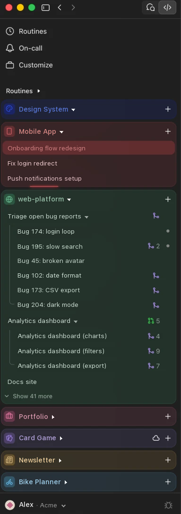

# Claude Colors

Color and icon each project in the Claude desktop app's Code sidebar, like tab groups in Arc.

<p align="center">
  
</p>

- Each project becomes a block tinted with its own color.
- Click a block's icon to pick one of 2,000+ [Lucide](https://lucide.dev) icons and a color.
- Each block shows its 5 latest sessions, with "Show more" for the rest.
- A light circles the border of a block while one of its sessions is running.
- Drag blocks to reorder them, folded or unfolded.

> **Unofficial.** This is not made or supported by Anthropic. It builds a modified copy of
> the Claude app on your Mac. Your original Claude app stays untouched.

## How it works

`patch.py` copies `/Applications/Claude.app` to `~/Applications/Claude Colors.app`. It adds
a small loader that injects `inject.js` into the sidebar, recolors the app icon so you can
tell the two apps apart, and signs the copy locally.

The copy reads `config.json` and `inject.js` from this folder. Edits to either apply live,
with no restart.

## Requirements

- macOS, with the Claude desktop app in `/Applications`
- Python 3 with Pillow: `python3 -m pip install --user pillow`

## Install with Claude Code

Paste this into a Claude Code session:

```text
Install Claude Colors from https://github.com/thomasdqr/claude-colors.
1. Clone it into ~/Documents/GitHub/claude-colors, unless I already have it there.
2. If `python3 -c "import PIL"` fails, install Pillow for that python3.
3. Run `python3 patch.py` in that folder.
4. Do not quit, move or modify /Applications/Claude.app.
5. When it's done, tell me to quit Claude and open ~/Applications/Claude Colors.app.
```

## Install by hand

```bash
git clone https://github.com/thomasdqr/claude-colors ~/Documents/GitHub/claude-colors
cd ~/Documents/GitHub/claude-colors
python3 patch.py
```

Then quit Claude and open `~/Applications/Claude Colors.app`. The first time, macOS may ask
for Keychain access: click "Always Allow".

## Use

- **Icon and color:** click the icon at the left of a project's name.
- **Config file:** `config.json` maps a project name to a color and a
  [Lucide icon name](https://lucide.dev/icons). The picker writes to it for you.

## Good to know

- **Run one app at a time.** Claude and Claude Colors share the same data and login, and
  running both makes them fight over each session. Claude Colors offers to quit Claude when
  it finds it open, at launch and while running.
- **Notifications** come from Claude Colors, with its own icon, and clicking one opens it.
  The copy has its own app ID for this, so macOS asks once to allow its notifications.
  To check them, run
  `touch .notify-test` in this folder: a test notification shows, and the result goes to
  `~/Library/Logs/Claude/claude-colors-notify.log`.
- **After each Claude update,** quit Claude Colors and run `python3 patch.py` again.
- **If the colors disappear,** the claude.ai sidebar probably changed. The markup
  `inject.js` relies on is listed at the top of that file.
- **Auto-update** doesn't work in the copy. That's expected: update the original app,
  then rebuild.
- **To remove it,** delete `~/Applications/Claude Colors.app` and use Claude as before.

## License

MIT. Lucide icons are under the ISC license, see `LUCIDE-LICENSE`.
