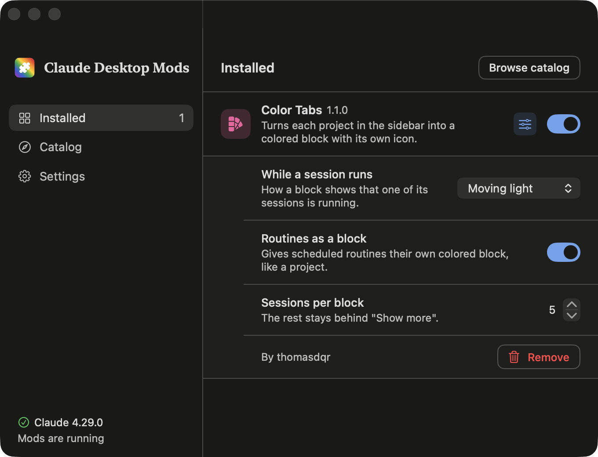
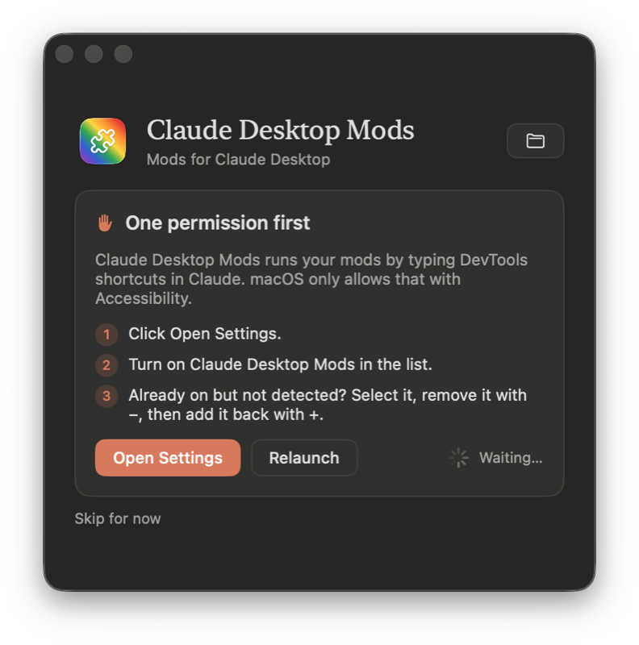
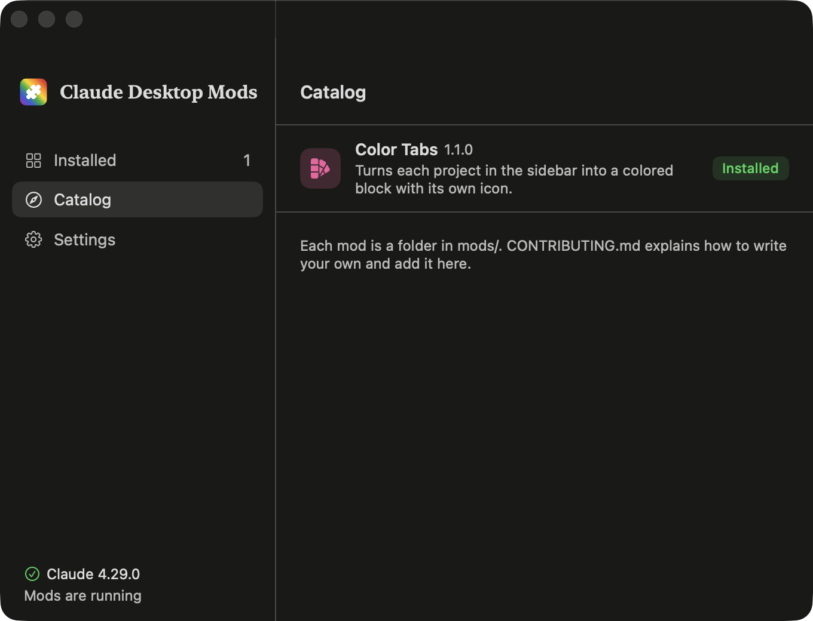
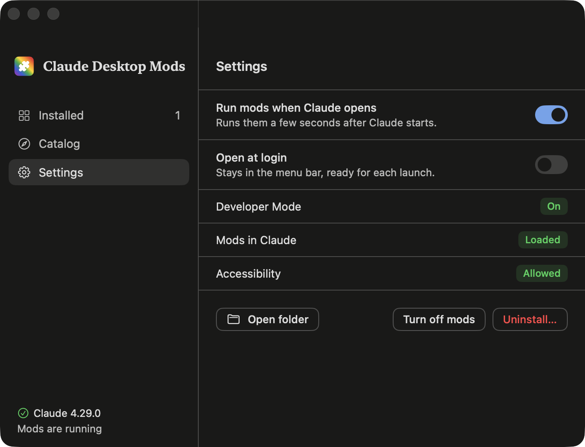

# Claude Desktop Mods

Mods to customize and extend the Claude desktop app, with a small Mac app to install, set up
and update them. CDM for short.

<p align="center">
  
  &nbsp;&nbsp;
  
</p>

> **Unofficial.** Not made, supported, or endorsed by Anthropic. CDM runs through Claude's
> own Developer Mode and DevTools; the Claude app itself is never modified.

## Mods

| Mod | What it does |
|---|---|
| [Color Tabs](mods/color-tabs) | Turns each project in the sidebar into a colored block with its own icon, like tab groups in Arc. Shows the latest sessions per block, and which block has a session running. |

Want to add yours? See [Writing a mod](CONTRIBUTING.md).

## Requirements

- macOS 14 or later, with the Claude desktop app
- Python 3 and git
- The Xcode command line tools: `xcode-select --install`

## Install

**1. Get the code and build the app.** In Terminal:

```bash
git clone https://github.com/thomasdqr/claude-desktop-mods ~/Documents/GitHub/claude-desktop-mods
python3 ~/Documents/GitHub/claude-desktop-mods/app/build.py
open ~/Applications/"Claude Desktop Mods.app"
```

**2. Allow Accessibility.** The app asks for it first: click **Open Settings** and turn on
Claude Desktop Mods. It needs it to type the DevTools shortcuts in Claude for you.

<p align="center">
  
</p>

**3. Install a mod.** Open **Catalog** and click **Install**, then **Restart Claude** in the
blue bar at the bottom. The mods run a few seconds after Claude opens, and again at each
launch. In **Settings**, turn on **Open at login** so the app is always ready in the menu bar.

## The app

**Installed** lists your mods. Each has a switch, and the sliders button opens its settings
and **Remove**. When a mod has a new version, **Update to …** appears next to it.

**Catalog** lists every mod in the repository, with **Install**.

<p align="center">
  
  &nbsp;
  
</p>

**Settings** has the app's own options, the state of each piece, **Turn off mods** and
**Uninstall…**.

A change applies when Claude restarts. The blue bar at the bottom says how many changes are
waiting and offers **Restart Claude**.

Your choices are saved in `settings.json`, which you can also edit by hand:

```json
{
  "mods": {
    "color-tabs": {
      "enabled": true,
      "settings": {
        "runningAnimation": "pulse",
        "routinesBlock": true,
        "visibleRows": 5,
        "projects": { "my-project": { "color": "#3DBE7A", "icon": "sprout" } }
      }
    }
  }
}
```

After editing it by hand, run `python3 install.py`. It waits for you to quit Claude, then
reopens it with your changes.

## Updates

The app checks for new versions when it opens, then every hour. **Update to …** pulls the
repository, which brings every mod's update and the catalog's new mods at once. Then
**Restart Claude** loads them.

When the app itself changed, it says so: run `python3 app/build.py` again to get it.

## Write a mod

A mod is a folder in `mods/` with a `manifest.json` and a `main.js`. Start from the
template, try it in Claude, then open a pull request to add it to everyone's catalog:
[CONTRIBUTING.md](CONTRIBUTING.md) explains each step.

```bash
cp -R template/my-mod mods/my-mod
python3 check_mods.py
```

## How it works

1. **Developer Mode.** The app turns on Claude's own Developer Mode, the same setting as
   Help → Enable Developer Mode…
2. **One snippet.** `install.py` bundles the runtime and the installed, switched-on mods into a
   DevTools snippet named `cdm`, and saves it in Claude while Claude is closed.
3. **At each launch.** The app opens DevTools tucked off-screen, runs the snippet with
   ⌘P → `!cdm`, then closes DevTools. It only takes a moment.

`install.py` only writes two of Claude's settings files, in
`~/Library/Application Support/Claude`: `developer_settings.json` and `Preferences`. It backs
`Preferences` up to `Preferences.cdm-backup` first.

## Without the app

```bash
python3 ~/Documents/GitHub/claude-desktop-mods/install.py
```

Quit Claude when it asks. Then, after each Claude launch, click in the sidebar and press
**⌥⌘I**, then **⌘P**, type `!cdm` and press **Enter**. To update, run `git pull` in the folder,
then `install.py` again.

## Uninstall

1. In the app, click **Settings → Uninstall…**. Claude restarts without mods, and the app
   moves to the Trash. Without the app, run
   `python3 ~/Documents/GitHub/claude-desktop-mods/uninstall.py`, then delete
   `~/Applications/Claude Desktop Mods.app`.
2. Remove Claude Desktop Mods from System Settings → Privacy & Security → Accessibility.
3. If you want, delete the `claude-desktop-mods` folder.

Uninstalling only removes what CDM added: the `cdm` snippet in Claude's DevTools and the
`Preferences.cdm-backup` file. Developer Mode goes back to how it was before CDM. The Claude
app, your conversations and Claude's settings stay as they are.

## Troubleshooting

- **The app doesn't compile** (for example "plugin for module 'SwiftUIMacros' not found").
  Pull the latest version and build again. If it still fails, install Xcode from the App Store.
- **Accessibility stays "Not allowed".** In System Settings, select Claude Desktop Mods,
  remove it with −, add `~/Applications/Claude Desktop Mods.app` back with +, then click
  **Relaunch** in the app.
- **The menu bar icon is missing.** macOS hides icons that don't fit, for example behind the
  notch. Hold ⌘ and drag other icons away, or hide some in System Settings → Menu Bar.
- **Update says the folder has changes of its own.** You edited files in the repository. Run
  `git status` in it, keep or drop your changes, then `git pull`.
- **A mod stops working after a Claude update.** Claude's markup probably changed; it's
  listed at the top of [`runtime/runtime.js`](runtime/runtime.js).
- **Coming from Claude Colors?** `install.py` moves your colors from `config.json` to
  `settings.json`, keeps your picker choices, and replaces the old snippet. Delete
  `~/Applications/Claude Colors.app` and its Accessibility entry.

## License

MIT. Lucide icons are under the ISC license, see
[`mods/color-tabs/LUCIDE-LICENSE`](mods/color-tabs/LUCIDE-LICENSE).
