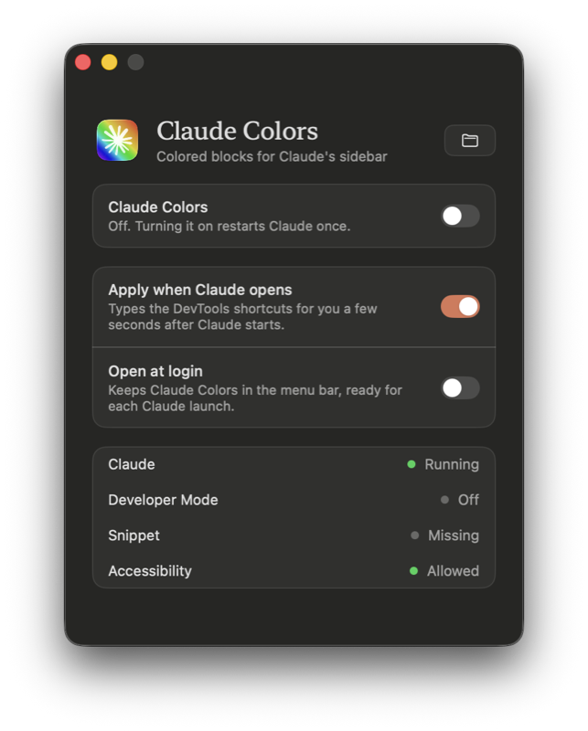

# Claude Colors

Color and icon each project in the Claude desktop app's Code sidebar, like tab groups in Arc.

<p align="center">
  
</p>

- Each project becomes a block tinted with its own color.
- Click a block's icon to pick one of 2,000+ [Lucide](https://lucide.dev) icons and a color.
- Each block shows its 5 latest sessions, with "Show more" for the rest.
- A light travels along a block's border while one of its sessions is running.
- Drag blocks to reorder them, folded or unfolded.

> **Unofficial.** This is not made or supported by Anthropic. It uses Claude's own Developer
> Mode and DevTools. The Claude app itself is never modified.

## Requirements

- macOS 14 or later, with the Claude desktop app
- Python 3 and git
- The Xcode command line tools, to build the launcher: `xcode-select --install`
- Optional: Pillow (`python3 -m pip install --user pillow`), for the launcher's rainbow icon

## Install

**1. Get the code and build the launcher.** In Terminal:

```bash
git clone https://github.com/thomasdqr/claude-colors ~/Documents/GitHub/claude-colors
python3 ~/Documents/GitHub/claude-colors/launcher/build.py
open ~/Applications/"Claude Colors.app"
```

**2. Allow Accessibility.** The launcher asks for it first: click **Open Settings** and turn
on Claude Colors. It needs it to type the DevTools shortcuts in Claude for you.

**3. Turn on Claude Colors.** Claude restarts once, and the colors appear a few seconds later.

<p align="center">
  
</p>

From then on, the launcher applies the colors each time Claude opens. Turn on
**Open at login** so it's always ready in the menu bar.

## Use

- **Icon and color:** click the icon at the left of a project's name. Your choices are saved
  in Claude itself, so they survive restarts.
- **Starting colors:** `config.json` maps a project name to a color and a
  [Lucide icon name](https://lucide.dev/icons). It's created from `config.example.json` the
  first time. Choices made with the picker win over it, project by project. After editing
  it, or after a `git pull`, turn Claude Colors off and on again in the launcher.

## How it works

1. **Developer Mode.** The launcher turns on Claude's own Developer Mode, the same setting as
   Help → Enable Developer Mode…
2. **A DevTools snippet.** `setup.py` bundles `inject.js`, `config.json` and the icons into
   one snippet, and saves it in Claude's DevTools while Claude is closed.
3. **At each launch.** The launcher opens DevTools tucked off-screen, runs the snippet with
   ⌘P → `!claude-colors`, then closes DevTools. It only takes a moment.

`setup.py` only writes two of Claude's settings files, in
`~/Library/Application Support/Claude`: `developer_settings.json` and `Preferences`. It backs
`Preferences` up to `Preferences.claude-colors-backup` first.

## Without the launcher

```bash
python3 ~/Documents/GitHub/claude-colors/setup.py
```

Quit Claude when it asks. Claude reopens with the snippet installed. Then, after each Claude
launch, click in the sidebar and press **⌥⌘I**, then **⌘P**, type `!claude-colors` and press
**Enter**.

## Uninstall

1. Turn Claude Colors off in the launcher, or run
   `python3 ~/Documents/GitHub/claude-colors/uninstall.py`. This turns Developer Mode off and
   removes the snippet.
2. Quit the launcher from its menu bar icon and delete `~/Applications/Claude Colors.app`.
3. Remove Claude Colors from System Settings → Privacy & Security → Accessibility.

## Troubleshooting

- **Accessibility stays "Not allowed".** In System Settings, select Claude Colors, remove it
  with −, add `~/Applications/Claude Colors.app` back with +, then click **Relaunch** in the
  launcher.
- **The colors disappear after a Claude update.** Claude's sidebar markup probably changed.
  The markup `inject.js` relies on is listed at the top of that file.
- **DevTools stays visible.** Close it once by hand: DevTools remembers where it was, and the
  launcher tucks it away on the next run.

## Older Claude versions

Before Claude 4.29, `patch.py` built a patched copy of the app that applied the colors on its
own. Claude 4.29 refuses modified copies, so the launcher and the snippet replace it.

## License

MIT. Lucide icons are under the ISC license, see `LUCIDE-LICENSE`.
