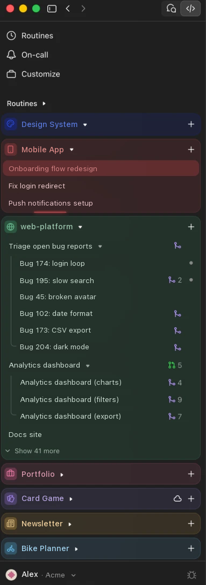

# Color Tabs

Turns each project in Claude's Code sidebar into a colored block with its own icon, like
tab groups in Arc.

<p align="center">
  
</p>

- **Icon and color per project.** Click a block's icon to pick from 2,000+
  [Lucide](https://lucide.dev) icons and a color. The choice is saved in Claude.
- **The latest sessions first.** Each block shows its latest sessions, and "Show more" for the
  rest.
- **A running session shows.** While a session runs, its block shows it.
- **Routines in a block.** Scheduled routines can get a block of their own.

## Settings

| Setting | What it does | Default |
|---|---|---|
| While a session runs | Moving light around the block, pulsing border, shimmer, breathing color, loading bar, spinner or dot on the icon, or none | Moving light |
| Routines as a block | Gives scheduled routines their own colored block | On |
| Sessions per block | How many sessions a block shows before "Show more" | 5 |

Starting colors and icons can also go in `settings.json`, under `projects`:

```json
"projects": { "my-project": { "color": "#3DBE7A", "icon": "sprout" } }
```

Routines get no running animation: Claude doesn't mark a routine as running in the sidebar.

Tested on Claude 4.29. Icons: Lucide, under the ISC license ([`LUCIDE-LICENSE`](LUCIDE-LICENSE)).
